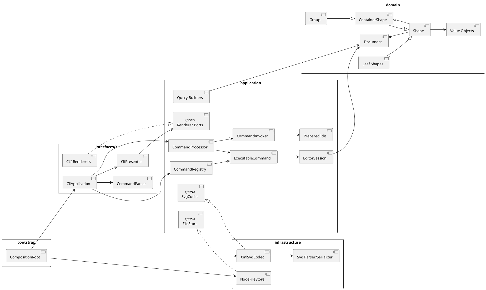

# PJ1 Phase 1：SVG 编辑器

## 1. 架构方案

### 1.1 架构目标

项目采用分层架构：

- **Command** 是所有编辑行为的唯一入口，CLI 不直接修改文档。
- 编辑命令使用 **PreparedEdit 反向操作**实现 undo/redo，不使用整文档快照。
- **ContainerShape + Composite** 统一表示图形树。
- Document 是已挂载树、id 索引和 shapeCount 的唯一所有者。
- SVG、文件系统和 CLI 通过 Port/Adapter 与核心逻辑隔离。
- 内置命令和图形也通过 Provider 注册。
- tree/show 返回结构化 Snapshot，CLI 只负责排版。

### 1.2 模块划分

```text
src/
  domain/
    model/          # Document、CanvasSize、ShapePlacement
    shapes/         # Shape、ContainerShape、Group、叶子图形、
                    # Point、Size、ShapeId、ShapeStyle 等值对象
  application/
    EditorSession.ts
    commands/       # Command、PreparedEdit、具体命令和 ShapeFeedback
    history/        # CommandProcessor、CommandInvoker
    extensions/     # CommandProvider、CommandRegistry
    queries/        # Tree/ShapeDetails Snapshot 和 Builder
    shapes/         # ShapeInit、ShapeProvider、ShapeFactory、providers
    ports/          # SvgCodec、FileStore、Renderer Ports
  infrastructure/
    svg/            # XmlSvgCodec、Parser、Serializer、IdAllocator、Transform
    fs/             # NodeFileStore
  interfaces/
    cli/            # REPL、Parser、Presenter 和具体 Renderer
  shared/errors/    # UserFacingError、UserInputError、CommandRejectedError
  bootstrap/        # CompositionRoot
  main.ts
tests/
  application/ commands/ domain/ infrastructure/
  interfaces/ shapes/ e2e/ support/
```

| 模块 | 职责 | 不承担 |
|---|---|---|
| `domain/model` | Document、画布尺寸、id 索引、父子关系、挂载状态 | CLI、XML、文件 IO |
| `domain/shapes` | Composite、图形操作、值对象和领域不变量 | 历史栈、命令分发 |
| `application/commands` | 准备、应用和反向执行操作 | 打印文本、直接访问 Node.js fs |
| `application/history` | 命令分类执行、历史栈和门禁 | 具体图形几何规则 |
| `application/queries` | 构建结构化 tree/show 结果 | CLI 排版 |
| `application/shapes` | Provider 注册、统一创建和公共样式应用 | 具体图形几何实现 |
| `application/ports` | SVG、文件和展示输出抽象 | 具体外部实现 |
| `infrastructure` | XML/SVG、文件系统、原子写入 | 修改命令历史 |
| `interfaces/cli` | REPL、参数解析、Snapshot 排版 | 保存领域状态 |
| `shared/errors` | 用户错误与内部异常分类 | 业务规则 |
| `bootstrap` | 注册实现并组装依赖 | 业务决策 |

### 1.3 包图



CompositionRoot 是唯一同时认识所有具体实现的组装位置。

### 1.4 设计模式与落地

#### Command + 反向命令

```typescript
interface UndoableCommand<TContext> {
  readonly kind: "edit";
  prepare(context: TContext): PreparedEdit<TContext>;
}

interface PreparedEdit<TContext> {
  apply(context: TContext): CommandResult;
  revert(context: TContext): CommandResult;
}
```

执行流程：

```text
CLI -> CommandParser -> CommandRegistry -> CommandProcessor
    -> 编辑命令：CommandInvoker -> prepare -> PreparedEdit.apply
    -> 文档/查询/控制命令：直接执行
    -> CommandResult/CommandView -> CliPresenter
```

CommandInvoker 只保存 PreparedEdit：

```text
execute：prepare -> apply -> 入 undo 栈并清空 redo
undo：revert 成功 -> 移入 redo 栈
redo：apply 成功 -> 移回 undo 栈
```

反向信息均为局部状态：

| 操作 | 反向信息 |
|---|---|
| create | 新图形、父容器、插入索引 |
| delete | 被删除子树、原父容器、索引 |
| move/scale | 受影响图形的 GeometryState |
| set | 修改前属性值 |
| group/ungroup | 原父节点、索引、成员顺序、原容器 |
| addto | 原父节点、原索引、目标容器 |
| front/back | 原同级索引 |

所有编辑命令遵循 `prepare -> apply`：易失败条件在 prepare 阶段检查，apply 只提交已准备好的修改。经验证，操作失败不会写入历史或改变文档。

#### Composite 与 Document 所有权

```text
Shape
├── LeafShape：Rect、Circle、Ellipse、Line、Text
└── ContainerShape
    └── Group
```

ContainerShape 统一提供 children、`walkTree`、递归 move/scale、循环检测和局部几何恢复。已挂载容器的 add/insert/remove 会被拒绝，所有结构修改必须经过 Document，以同步父子关系、id 索引、shapeCount 和 attached 状态。

#### Provider / Factory

- `ShapeProvider.createFromCliArgs` 将 CLI 参数转换为中立的 ShapeInit。
- `ShapeProvider.create(ShapeInit)` 同时服务 CLI 创建和 SVG 读取。
- ShapeFactory 集中完成类型分派、Provider 调用和公共样式应用。
- CommandProvider 提供命令名称、usage、解析和命令创建。
- 内置命令和图形在 CompositionRoot 中使用同一注册路径。

按名字分派只有两处，均标记为待重构：

| 位置 | 内容 | 后续方向 |
|---|---|---|
| CommandRegistry | 命令名 → CommandProvider | 插件元数据驱动注册 |
| ShapeFactory | 图形类型名 → ShapeProvider | 完整插件注册表 |

#### Port / Adapter 与 Snapshot

- SvgCodec 隔离 XML/SVG，XmlSvgCodec 内部拆为 Parser、Serializer、IdAllocator。
- FileStore 隔离文件系统；NodeFileStore 使用临时文件加 rename 原子保存。
- tree/show 返回 TreeSnapshot/ShapeDetailsSnapshot；Command 不依赖 CLI Renderer。
- GUI 或智能体可直接复用 Snapshot，CLI Presenter 可替换。

#### 值对象和错误分类

CanvasSize、Point、Size、ShapeId、ShapeStyle、GeometryState 保证正数、有限坐标、非空 id 和可精确恢复的局部状态。move/scale 先计算完整目标状态，再一次性提交。

UserInputError 和 CommandRejectedError 属于用户可处理错误；CLI 只格式化这些错误，TypeError 等内部故障会保留为程序缺陷。

### 1.5 依赖方向

| 来源 | 可以依赖 | 理由 |
|---|---|---|
| interfaces/cli | application、shared | CLI 是应用用例的输入输出适配器 |
| application | domain、自身 ports、shared | 编排领域逻辑，不持有外部实现 |
| domain | 仅领域内部与 shared 无外设类型 | 核心规则独立、可测试 |
| infrastructure | application ports、domain | 实现 SVG/文件系统适配器 |
| bootstrap | 所有模块 | 唯一依赖组装位置 |

禁止：

- domain 导入 CLI、Infrastructure、Node.js fs 或 XML 库。
- Command 直接打印或访问具体文件/SVG 实现。
- CLI 绕过 CommandProcessor 修改 Document。
- 已挂载 ContainerShape 绕过 Document 修改结构。
- 多处重复命令名或图形类型分派。

### 1.6 变化点与阶段边界

| 变化点 | 预留方式 | 当前决定 |
|---|---|---|
| 新增图形或 box 插件 | ShapeProvider、ShapeFactory、ContainerShape、Descriptor | 不实现插件加载器；接口已备 |
| 新增命令或输入入口 | CommandProvider、CommandProcessor、CommandView | 不引入事件总线 |
| GUI/智能体 | 命令结果与 Snapshot 不绑定文本 | CLI Presenter 可替换 |
| SVG transform/属性扩展 | Codec、Parser、Serializer、ShapeInit | 支持 translate 和等比 scale |
| 大文档历史增长 | 命令只保存局部状态 | 先测量再优化 |
| 历史持久化 | 历史层只依赖 PreparedEdit | Phase 1 不持久化 |

Phase 1 边界：

- `box` 不实现，`create box` 返回未注册类型错误。
- transform 在读取时归一化为图形坐标，保存输出规范 SVG。
- rotate、matrix、非等比 scale 明确拒绝。
- 不承诺任意外部 SVG 的未知元素和属性完整 round-trip。

## 2. 过程记录

1. 最初考虑整文档 Memento，最终按高扩展性要求改为 PreparedEdit 反向命令。
2. 发现 CreateShapeCommand 存在隐藏可变准备状态，重构为显式 `prepare -> PreparedEdit`。
3. E2E 测试发现 `addto` 后图形脱离 Document id 索引，修复为 `detach -> Document.insertShapeAt`。
4. 为从结构上避免同类问题，引入 attached 状态和 Document 唯一结构修改入口。
5. 删除中心 ShapeVisitor，改用 ShapeDescriptor、ContainerShape.walkTree 和多态 SVG 属性。
6. 将 XmlSvgCodec 拆分为 Parser、Serializer、IdAllocator，并将测试从重复编译优化为预构建一次。
7. 将 tree/show 从文本改为 Snapshot，查询和排版分离。
8. 根据文档 transcript 修正 create-in、move、tree text、show 和恢复反馈格式。
9. 加强值对象与不变量，修复 canvas 查询清空历史、未初始化 undo/redo、非原子保存、插件容器 ungroup 和 Text transform 属性问题。

## 3. 一致性自查

### 3.1 模块划分

- 实际目录与本文档一致。
- 修订记录覆盖值对象位置、XmlSvgCodec 拆分、queries 和 errors 模块。
- 查询、Renderer 和领域模型职责已分离。
- 已挂载容器结构修改统一经过 Document。

### 3.2 依赖与分派

- domain 未导入 CLI、Infrastructure、Node.js fs 或 XML 库。
- CLI 只通过 CommandRegistry/CommandProcessor 执行命令。
- 命令名分派只集中于 CommandRegistry。
- 图形类型分派只集中于 ShapeFactory。
- SVG Parser 通过 ShapeFactory 创建图形。
- Command 不依赖 CLI Renderer。

### 3.3 行为

- 支持的编辑操作均使用 PreparedEdit。
- Group 与叶子图形统一支持标准操作。
- 结构命令恢复原父节点、成员顺序和 z-order。
- 失败的结构修改不改变文档或历史。
- 文档命令清空历史并门禁 undo/redo。
- 普通 tree/show/help/canvas 查询不属于文档修改。
- redo 后新编辑清空 redo 栈。
- 插件复合容器可通过 canUngroup=false 禁止 ungroup。

## 4. 质量保证

截至本文档更新：

```text
npm test
Test Files  23 passed
Tests       87 passed

npm run typecheck
通过

npm run build
通过
```

测试分层：

- 领域值对象、Composite、容器挂载不变量测试。
- CommandInvoker 异常安全、undo/redo 和 redo 清空测试。
- 所有编辑命令的 prepare/apply/revert 和结构恢复测试。
- CLI 参数解析、quoted text、help 和结构化查询测试。
- SVG Parser/Serializer、IdAllocator、transform、原子文件写入测试。
- save/read round-trip、缺 id warning 测试。
- 文档完整 transcript、标准错误矩阵和单场景全功能验收测试。

关键验收能力：

- 六种 Phase 1 图形与 Group 的创建和递归编辑。
- create-in、group、ungroup、addto、front/back。
- move/scale/set/delete 的精确 undo/redo。
- canvas、save、read 和 IO 历史门禁。
- 嵌套 SVG 保存、读取和结构保持。
- translate、等比 scale、Text font-size/text-anchor round-trip。
- 缺 id 自动补全、quoted text 和含空格参数。
- 用户错误与内部异常分类。

# Phase 2 第一部分：VSCode 插件实践

## 1. 功能与验收证据

扩展源码位于 `vscode-extension/`，提供两个功能：

1. 在 Explorer 中为普通 `.svg` 文件显示 `[]` 标记。
2. 在 VSCode 原生 Outline 中显示 SVG 元素的嵌套结构，并支持点击定位源码。

扩展不会修改文件名或文件内容。示例文件位于：

- `vscode-extension/examples/example.svg`
- `vscode-extension/examples/uppercase.SVG`
- `vscode-extension/examples/notes.txt`
- `vscode-extension/examples/folder.svg/`

### 1.1 文件标记截图


预期结果：

- `example.svg` 和 `uppercase.SVG` 右侧显示 `[]`。
- `notes.txt` 不显示标记。
- `folder.svg` 是目录，不显示标记。
- 文件名和文件内容保持不变。

### 1.2 SVG 大纲与源码定位截图


预期结果：

- Outline 展示根元素、容器和叶子元素。
- 有 id 的元素显示为 `标签名#id`。
- 没有 id 的元素只显示标签名。
- 点击 `rect#start` 后定位到对应源码。
- 编辑合法 SVG 后，Outline 更新。

### 1.3 异常 XML 截图


不完整 XML 的允许行为是暂时清空 Outline。修复 XML 后，Outline 恢复。

### 1.4 自动化验证

`vscode-extension/test/` 中的 Vitest 测试覆盖：

- SVG 文件识别和装饰资格。
- 非 SVG 文件、目录和非文件 scheme 不产生装饰。
- 合法 SVG 的层级、顺序、id、自闭合标签和源码范围。
- 不完整 XML 返回空结果。
- 编辑后新增、修改、删除节点。
- Outline 节点到 `DocumentSymbol` 的递归映射。
- Provider 的激活和销毁生命周期。

`vscode-extension/integration-test/` 使用 `@vscode/test-electron` 启动真实 Extension Host，验证：

- 扩展能在真实 VSCode 中激活。
- VSCode 确实调用了注册的 SVG `DocumentSymbolProvider`。
- 大纲层级和源码范围正确。
- 编辑文档后 Symbol 树刷新。
- 不完整 XML 返回空大纲。
- 修复 XML 后大纲恢复。

运行命令：

```powershell
cd vscode-extension
npm test
npm run test:integration
```

## 2. 分析

### 2.1 VSCode 与扩展的职责

VSCode 是扩展宿主、文档模型和界面渲染者。扩展只提供附加信息以及从文档生成 Symbol 的能力。

| 职责 | VSCode | SVG 扩展 |
|---|---|---|
| 启动与生命周期 | 调用 `activate(context)`，保存扩展上下文 | 创建并注册 provider |
| 文件模型 | 管理 `Uri`、`TextDocument` 和文件系统 | 判断 URI 是否为 SVG，查询文件类型 |
| Explorer | 决定 Explorer 布局并绘制文件装饰 | 为合格 SVG 返回 `FileDecoration` 元数据 |
| Outline | 决定 Outline 的展示、选择、定位和刷新 | 返回嵌套的 `DocumentSymbol[]` |
| 编辑事件 | 在文档变化后重新请求 Symbol Provider | 每次调用读取最新 `document.getText()` |
| 销毁 | 释放 `context.subscriptions` | Provider 本身不持有需要手动清理的外部资源 |

扩展不能直接改变 Explorer 的绘制方式，也不能强制 Outline 刷新。扩展只实现 VSCode 公开的 Provider 接口，由 VSCode 根据当前工作区、文件类型和文档状态决定何时调用这些接口。

### 2.2 注册、回调和调用关系

当前实现在 `vscode-extension/src/extension.ts` 中完成组合根职责：

1. `activate(context)` 创建 `VscodeSvgEntryInspector`。
2. 创建 `SvgFileDecorationProvider`，并注入文件类型查询能力。
3. 创建 `SvgOutlineDocumentSymbolProvider`。
4. 调用 `window.registerFileDecorationProvider` 注册文件装饰。
5. 调用 `languages.registerDocumentSymbolProvider`，以 `{ scheme: "file", pattern: "**/*.svg" }` 注册大纲。
6. 把两个注册返回的 `Disposable` 放入 `context.subscriptions`。

Provider 每次激活都重新创建，不使用模块级共享实例。这样避免了多次激活之间的状态泄漏，也把资源生命周期绑定到当前 `ExtensionContext`。

文件装饰的调用关系如下：

```text
VSCode Explorer
  -> FileDecorationProvider.provideFileDecoration(uri)
  -> isSvgUri(uri)
  -> VscodeSvgEntryInspector.inspect(uri)
  -> workspace.fs.stat(uri)
  -> FileType -> SvgEntryKind
  -> { badge: "[]" } 或 undefined
  -> VSCode 绘制 Explorer 标记
```

非 SVG URI 在调用 `workspace.fs.stat` 前直接返回 `undefined`。SVG URI 只有在文件类型为普通文件时才返回 `{ badge: "[]" }`，所以目录不会获得标记。

Outline 的调用关系如下：

```text
VSCode 打开 .svg 文本文件
  -> DocumentSymbolProvider.provideDocumentSymbols(document)
  -> document.getText()
  -> SvgOutlineParser.parse(...)
  -> SvgOutlineSymbolMapper.map(document, root)
  -> DocumentSymbol[]
  -> VSCode 渲染原生 Outline
```

解析器返回轻量 `SvgOutlineNode`，不依赖 Phase 1 的 `Document`、`Shape` 或 `ShapeFactory`。`SvgOutlineSymbolMapper` 再把轻量节点转换为 VSCode 的 `DocumentSymbol` 和 `Range`。

如果 XML 暂时不完整，解析器返回 `null`，Provider 返回空数组。如果解析过程中出现意外异常，Provider 会捕获异常并返回空大纲，避免扩展宿主崩溃。

### 2.3 接口与对象组合

扩展使用三个内部边界：

```typescript
type InspectSvgEntry = (uri: Uri) => Promise<SvgEntryKind>;

type SvgOutlineParser = (
  source: string
) => SvgOutlineNode | null;

interface SvgOutlineSymbolMapping {
  map(document: TextDocument, root: SvgOutlineNode): DocumentSymbol[];
}
```

对象组合关系如下：

```text
activate
├── VscodeSvgEntryInspector
│   └── workspace.fs.stat
├── SvgFileDecorationProvider
│   └── InspectSvgEntry
└── SvgOutlineDocumentSymbolProvider
    ├── SvgOutlineParser
    └── SvgOutlineSymbolMapping
        └── DocumentSymbol
```

`SvgFileDecorationProvider` 和 `SvgOutlineDocumentSymbolProvider` 都通过构造函数获得可变依赖，因此可以在单元测试中注入测试替身。`extension.ts` 只负责实例化和注册，不实现文件系统判断、解析或 Symbol 映射逻辑。

涉及的主要 VSCode 接口是：

- `FileDecorationProvider`
- `DocumentSymbolProvider`
- `TextDocument`
- `DocumentSymbol`
- `Range`

内部代码没有继承 VSCode UI 类，而是实现接口并组合依赖，避免扩展逻辑和界面实现形成继承耦合。

### 2.4 文件装饰与经典 Decorator 的关系

经典 GoF Decorator 的典型结构是：

```text
Client -> Decorator -> Concrete Component
```

Decorator 通常持有被装饰对象，在把调用委托给原对象前后增加行为。被装饰对象和 Decorator 实现共同的接口，客户端仍然操作同一个组件抽象。

VSCode 的 `FileDecorationProvider` 与本项目中的 SVG 文件装饰有如下相似点：

- 都向原有对象增加显示信息。
- 都不修改原始文件内容。
- 都通过组合方式扩展行为。
- 都不需要修改 Explorer 或 VSCode 文件系统的内部实现。

但两者有本质差异：

| 比较项 | 经典 Decorator | VSCode 文件装饰 Provider |
|---|---|---|
| 是否包装目标对象 | 是，通常持有 Component 引用 | 否，只接收目标 `Uri` |
| 是否委托原对象行为 | 是 | 否 |
| 是否实现目标和装饰器的共同接口 | 是 | Provider 实现 VSCode 扩展接口 |
| 状态和调用权 | 由装饰器和客户端控制 | 由 VSCode 决定何时调用 |
| 输出 | 包装后的对象 | `FileDecoration` 展示元数据 |
| 是否改变文件模型 | 可改变对象行为 | 不改变文件模型 |

因此，本项目中的“文件装饰”不是严格的 GoF Decorator。它更接近 Decorator-style Provider/Strategy：VSCode 定义稳定的 Provider 接口，扩展在接口背后提供附加展示策略，最终绘制由 VSCode 完成。

### 2.5 与 Adapter 模式的关系

本项目包含两个明确的适配边界：

1. `VscodeSvgEntryInspector` 把 VSCode 的 `workspace.fs.stat` 和数值型 `FileType` 适配为领域侧的 `SvgEntryKind`。
2. `SvgOutlineDocumentSymbolProvider` 和 `SvgOutlineSymbolMapper` 把内部轻量 Outline 模型适配为 VSCode 的 `DocumentSymbol`、`Position` 和 `Range`。

它们的角色对应关系是：

| Adapter 角色 | 文件系统适配 | Outline 适配 |
|---|---|---|
| Target | `SvgEntryKind` 查询 | `DocumentSymbolProvider` |
| Client | `SvgFileDecorationProvider` | VSCode Outline |
| Adapter | `VscodeSvgEntryInspector` | Outline Provider/Mapper |
| Adaptee | `workspace.fs.stat` | VSCode `DocumentSymbol` API |

`FileDecorationProvider` 接口本身同时具有 Provider 和 Adapter 特征：扩展通过它接入 VSCode 的 Explorer 展示机制，但最终展示责任仍在 VSCode。

### 2.6 Phase 1 复用可能性评估

Phase 1 和 VSCode 扩展共享 TypeScript、SVG 文本输入和树形结构概念，但目标不同。
Phase 1 解析器服务于完整编辑器和几何模型；扩展只需要源码范围、标签名和 id。

| Phase 1 代码 | 是否直接复用 | 原因与替代方案 |
|---|---|---|
| `SvgDocumentParser` | 否 | 要求完整合法 SVG，依赖 `ShapeFactory`，并将元素转换为图形对象；不能保留 VSCode 所需源码 offset |
| `SvgIdAllocator` | 否 | 它会为无 id 元素自动分配 id；Outline 需要区分“有无显式 id” |
| `Document` | 否 | 负责挂载树、id 索引和结构不变量，超出 Outline 需要 |
| `Shape` 和各具体图形 | 否 | 包含几何和 SVG 语义；Outline 节点只需要标签、id、children 和 range |
| `ContainerShape.walkTree` | 思路可复用 | 使用相同的前序/递归遍历思想，但扩展使用独立只读轻量节点 |
| `ShapeDescriptor` | 思路可借鉴 | `标签名 + id` 的展示思想相近，但扩展不依赖 Phase 1 领域模型 |
| `fast-xml-parser` 配置 | 否 | 当前配置不提供 VSCode 所需的稳定源码范围，且完整 XML 解析不适合编辑中的半成品 |
| 错误分类与测试思路 | 可借鉴 | 可借鉴“非法输入不破坏状态”的测试原则，但不直接复用 CLI 错误类 |

当前扩展没有导入 Phase 1 的 `src/domain`、`ShapeFactory` 或 `Document`，因此 VSCode 部分可以独立构建和测试。扩展使用独立的 `svgOutlineParser.ts`，在遍历时记录开始标签、结束标签和标签名 offset，能够直接映射到 VSCode 的 `Range`。

未来如果两个部分都需要更复杂的 XML 处理，可以把“带源码位置的纯 XML tokenizer”抽成共享模块，但不应直接共享 CLI 领域模型。这样既能复用语法扫描能力，又能保持 CLI 编辑语义与 VSCode 展示语义的边界。

